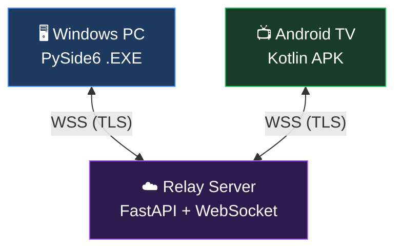
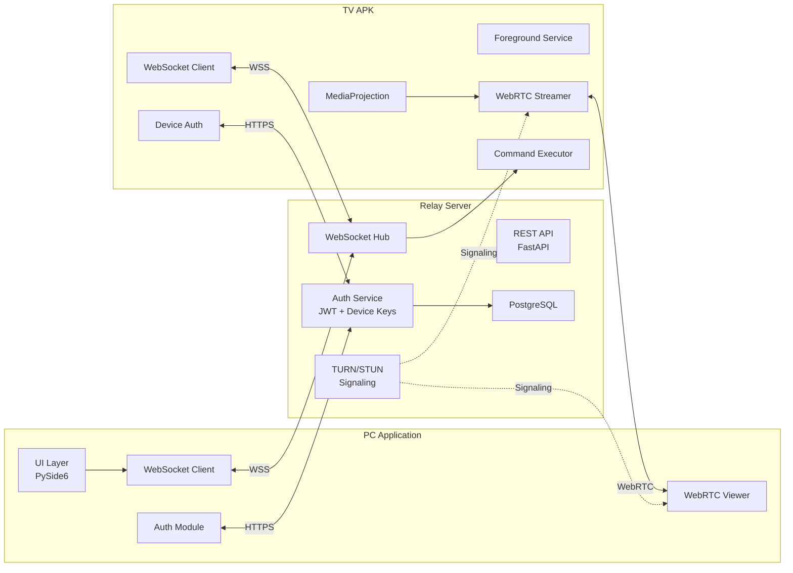
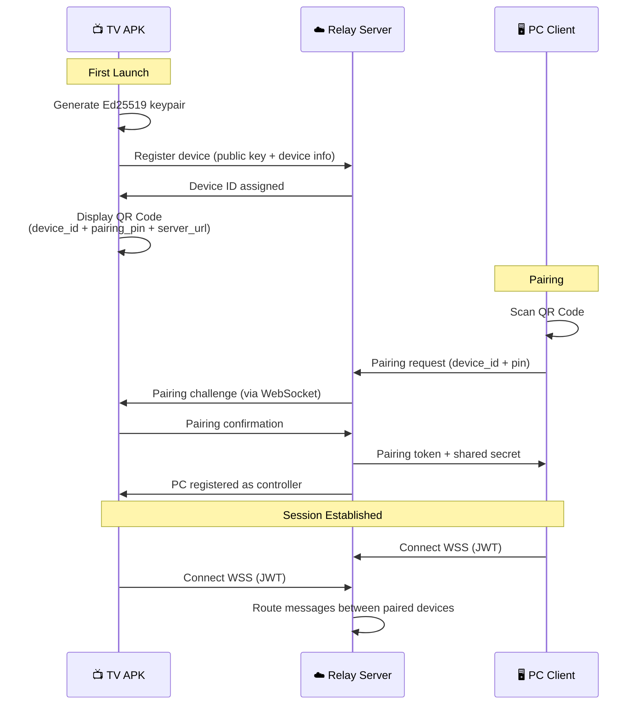
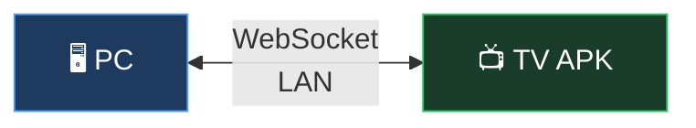
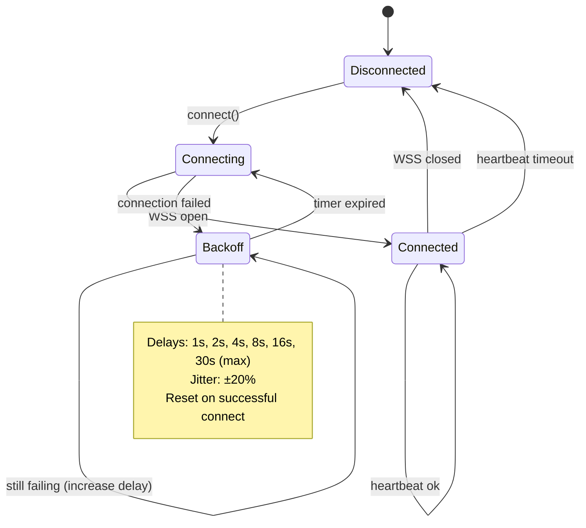
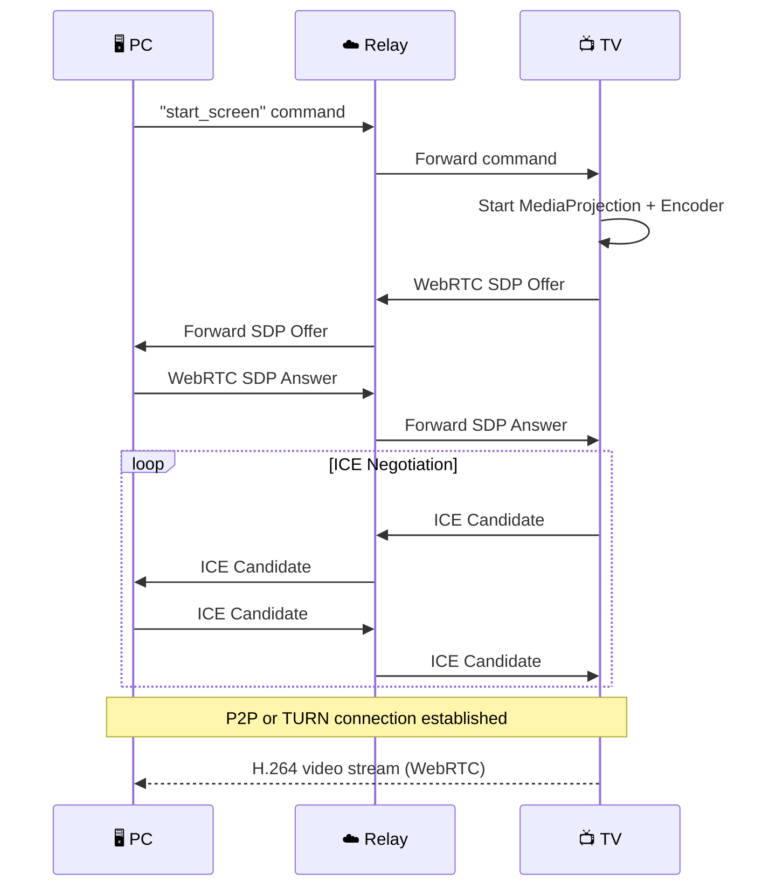
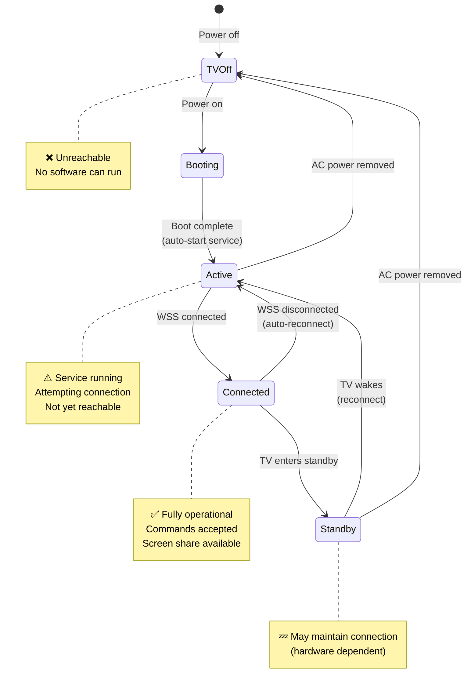
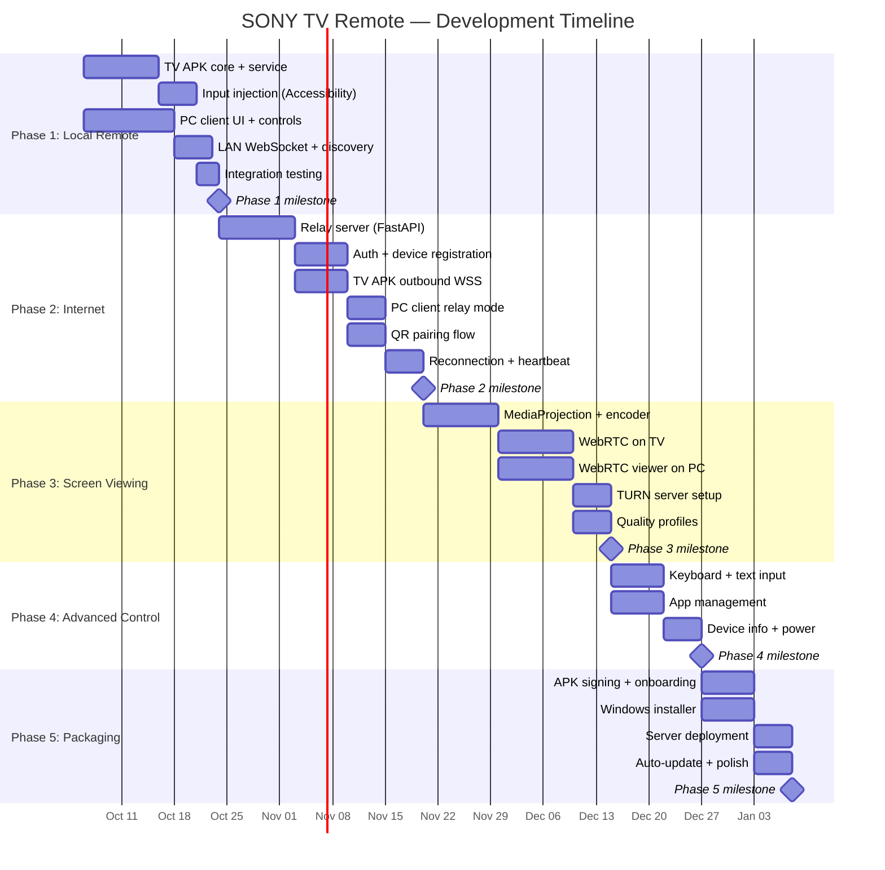

# 🎮 SONY TV — Remote Access System Implementation Plan

> **Project**: Personal Remote-Access System for Android TV  
> **Codename**: SONY TV  
> **Date**: October 2, 2026  
> **Status**: Draft v1.0

---

## 1. Executive Summary

Build a secure, cross-platform remote-access system consisting of:

| Component | Technology | Deliverable |
|-----------|-----------|-------------|
| **TV Agent** | Kotlin / Android | `RemoteTV.apk` |
| **Relay Server** | FastAPI (Python) | Cloud-hosted API |
| **PC Client** | PySide6 (Python) | `RemoteTV-Setup.exe` |



> [!IMPORTANT]
> Neither the PC nor the TV exposes any ports to the public internet. Both establish **outbound-only** encrypted connections to the relay server. This eliminates port-forwarding and NAT traversal issues entirely.

---

## 2. Architecture Deep Dive

### 2.1 System Architecture



### 2.2 Communication Protocol

```
┌─────────────────────────────────────────────────────────┐
│                    Message Envelope                      │
├──────────┬──────────┬───────────┬───────────────────────┤
│ version  │ msg_type │ timestamp │ payload (encrypted)   │
│ uint8    │ uint8    │ int64     │ bytes                 │
├──────────┴──────────┴───────────┴───────────────────────┤
│                                                         │
│  msg_type:                                              │
│    0x01  COMMAND        (PC → TV)                       │
│    0x02  RESPONSE       (TV → PC)                       │
│    0x03  HEARTBEAT      (bidirectional)                  │
│    0x04  DEVICE_STATUS  (TV → Server)                   │
│    0x05  SCREEN_OFFER   (TV → PC, WebRTC SDP)          │
│    0x06  SCREEN_ANSWER  (PC → TV, WebRTC SDP)          │
│    0x07  ICE_CANDIDATE  (bidirectional)                  │
│    0x08  AUTH_CHALLENGE (Server → Device)                │
│    0x09  AUTH_RESPONSE  (Device → Server)                │
│                                                         │
└─────────────────────────────────────────────────────────┘
```

### 2.3 Command Schema

```json
{
  "version": 1,
  "type": "COMMAND",
  "id": "uuid-v4",
  "timestamp": 1696271526000,
  "device_id": "tv-living-room-abc123",
  "command": {
    "category": "remote_control",
    "action": "KEY_DPAD_UP",
    "params": {}
  }
}
```

**Supported command categories:**

| Category | Actions | Phase |
|----------|---------|-------|
| `remote_control` | `KEY_DPAD_UP`, `KEY_DPAD_DOWN`, `KEY_DPAD_LEFT`, `KEY_DPAD_RIGHT`, `KEY_DPAD_CENTER`, `KEY_BACK`, `KEY_HOME`, `KEY_MENU` | Phase 1 |
| `volume` | `KEY_VOLUME_UP`, `KEY_VOLUME_DOWN`, `KEY_MUTE` | Phase 1 |
| `power` | `KEY_POWER`, `KEY_SLEEP`, `KEY_WAKEUP` | Phase 1 |
| `media` | `KEY_MEDIA_PLAY_PAUSE`, `KEY_MEDIA_STOP`, `KEY_MEDIA_NEXT`, `KEY_MEDIA_PREVIOUS`, `KEY_MEDIA_REWIND`, `KEY_MEDIA_FAST_FORWARD` | Phase 1 |
| `input` | `KEY_0`–`KEY_9`, `KEY_CHANNEL_UP`, `KEY_CHANNEL_DOWN` | Phase 1 |
| `text_input` | `inject_text`, `inject_keystrokes` | Phase 4 |
| `app` | `launch_app`, `list_apps`, `force_stop_app` | Phase 4 |
| `device` | `get_info`, `screenshot`, `reboot`, `get_brightness`, `set_brightness` | Phase 4 |
| `screen` | `start_stream`, `stop_stream`, `set_quality` | Phase 3 |

---

## 3. Security Architecture

### 3.1 Pairing Flow



### 3.2 Authentication Stack

| Layer | Mechanism | Purpose |
|-------|-----------|---------|
| Transport | TLS 1.3 | Encryption in transit |
| Device Identity | Ed25519 keypair | Device authentication |
| Session | JWT (short-lived, 15 min) | Request authorization |
| Refresh | Refresh token (long-lived, 30 days) | Token renewal |
| Pairing | One-time PIN + QR | Device-to-device trust |
| Command Auth | Per-command permission check | Prevent unauthorized actions |
| Optional | TOTP 2FA | Extra account security |

### 3.3 Threat Mitigations

| Threat | Mitigation |
|--------|-----------|
| Man-in-the-middle | TLS 1.3 + certificate pinning |
| Replay attacks | Nonce + timestamp validation (±30s window) |
| Stolen device token | Remote device revocation via server |
| Brute-force pairing | Rate limiting + PIN expiry (5 min) |
| Unauthorized commands | Per-device command allow-list |
| Server compromise | End-to-end encryption for sensitive commands (optional Phase 5) |

---

## 4. Phase Breakdown

### Phase 1 — Local Remote Control 🏠

> **Goal**: PC controls TV over LAN with full D-pad, volume, power, and media controls.  
> **Duration**: 3–4 weeks  
> **Complexity**: ⭐⭐



#### 4.1.1 TV APK (Kotlin)

| Task | Details |
|------|---------|
| Project setup | Android Studio, target API 28+ (Android TV) |
| Leanback launcher integration | TV-compatible activity with banner icon |
| Local WebSocket server | Ktor or OkHttp WebSocket (listens on LAN) |
| Input injection | `Instrumentation` API or `AccessibilityService` for keycode dispatch |
| Service lifecycle | Foreground service with persistent notification |
| mDNS/SSDP discovery | Broadcast device presence on LAN for auto-discovery |
| Basic auth | Simple shared secret for LAN pairing |

**Input injection approach** (no root required):

```
Option A: AccessibilityService
  ✅ Can inject key events globally
  ✅ Survives process restart
  ✅ Works on Android TV
  ⚠️ Requires user to enable in Settings → Accessibility

Option B: Instrumentation API
  ⚠️ Limited to app's own window
  ❌ Not suitable for system-wide control

Option C: ADB over network (adb shell input)
  ✅ Full system control
  ⚠️ Requires ADB debugging enabled
  ⚠️ Security implications
  
→ Recommended: AccessibilityService (Option A) as primary
→ Fallback: ADB-over-network (Option C) for power users
```

**Background persistence strategy:**

```kotlin
// Foreground Service with COMPANION_DEVICE_MANAGER for extended background
class TVAgentService : Service() {
    override fun onCreate() {
        // 1. Start as foreground service (required for Android 8+)
        startForeground(NOTIFICATION_ID, createNotification())
        
        // 2. Request FOREGROUND_SERVICE_CONNECTED_DEVICE type
        //    (Android 14+ requires declaring foreground service type)
        
        // 3. Use WorkManager for periodic reconnection heartbeat
        
        // 4. Register BOOT_COMPLETED receiver for auto-start
    }
}
```

> [!TIP]
> On Android TV, foreground services with the `connectedDevice` type get more lenient background execution limits. Combine with `WorkManager` periodic tasks for reconnection resilience.

#### 4.1.2 PC Client (PySide6)

| Task | Details |
|------|---------|
| Project setup | Python 3.11+, PySide6, `websockets` library |
| UI: Device discovery | Scan LAN for TV via mDNS/SSDP |
| UI: D-pad cluster | Directional pad + OK button |
| UI: Control bar | Home, Back, Menu buttons |
| UI: Volume bar | Vol+, Vol−, Mute |
| UI: Power controls | Power, Sleep |
| UI: Media controls | Play/Pause, Stop, Next, Previous |
| Keyboard shortcuts | Arrow keys, Enter, Backspace, etc. mapped to TV commands |
| Connection status | Online/offline indicator with latency display |

**UI Mockup concept:**

```
╔══════════════════════════════════════════╗
║  🎮 SONY TV Remote                      ║
╠══════════════════════════════════════════╣
║                                          ║
║  📺 Living Room TV        ● Connected   ║
║     Latency: 12ms                        ║
║                                          ║
║  ┌─────────────────────────────────────┐ ║
║  │            ┌─────┐                  │ ║
║  │            │  ▲  │                  │ ║
║  │     ┌──────┼─────┼──────┐          │ ║
║  │     │  ◄   │ OK  │  ►   │          │ ║
║  │     └──────┼─────┼──────┘          │ ║
║  │            │  ▼  │                  │ ║
║  │            └─────┘                  │ ║
║  │                                     │ ║
║  │  🏠 Home    ↩ Back    ☰ Menu       │ ║
║  │                                     │ ║
║  │  🔉 Vol−    🔇 Mute    🔊 Vol+    │ ║
║  │                                     │ ║
║  │  ⏮ Prev   ⏯ Play    ⏭ Next      │ ║
║  │                                     │ ║
║  │  ⏻ Power                  💤 Sleep │ ║
║  └─────────────────────────────────────┘ ║
║                                          ║
║  [ 📺 View Screen ] [ ⌨ Keyboard ]     ║
║  [ 📱 Apps ]        [ ⚙ Settings ]     ║
║                                          ║
╚══════════════════════════════════════════╝
```

#### 4.1.3 Deliverables

- [ ] TV APK installable via sideload (`.apk`)
- [ ] PC client runs from source (`python main.py`)
- [ ] D-pad, OK, Back, Home, Menu, Volume, Mute, Power, Media controls
- [ ] LAN auto-discovery
- [ ] Basic connection status display
- [ ] Keyboard shortcut mapping

---

### Phase 2 — Internet Connectivity 🌐

> **Goal**: PC controls TV over the internet via a secure relay server.  
> **Duration**: 4–5 weeks  
> **Complexity**: ⭐⭐⭐


#### 4.2.1 Relay Server (FastAPI)

| Task | Details |
|------|---------|
| Project setup | FastAPI + Uvicorn, PostgreSQL, Redis |
| REST API | `/auth/register`, `/auth/login`, `/auth/refresh`, `/devices`, `/devices/{id}/pair` |
| WebSocket hub | Authenticated WSS endpoints, message routing between paired devices |
| Device registry | Store device info, status, last seen timestamp |
| Auth service | JWT issuance, refresh tokens, device key verification |
| Heartbeat manager | Track device liveness, mark offline after 3 missed pings |
| Rate limiting | Per-device and per-IP rate limits |
| Logging & monitoring | Structured logging, health check endpoint |

**Database schema (PostgreSQL):**

```sql
-- Users
CREATE TABLE users (
    id          UUID PRIMARY KEY DEFAULT gen_random_uuid(),
    email       VARCHAR(255) UNIQUE NOT NULL,
    password    TEXT NOT NULL,  -- bcrypt hash
    totp_secret TEXT,           -- optional 2FA
    created_at  TIMESTAMPTZ DEFAULT NOW()
);

-- Devices (TVs)
CREATE TABLE devices (
    id              UUID PRIMARY KEY DEFAULT gen_random_uuid(),
    user_id         UUID REFERENCES users(id),
    device_name     VARCHAR(255) NOT NULL,
    device_type     VARCHAR(50) DEFAULT 'android_tv',
    public_key      TEXT NOT NULL,        -- Ed25519 public key
    status          VARCHAR(20) DEFAULT 'offline',
    last_seen       TIMESTAMPTZ,
    android_version VARCHAR(20),
    model           VARCHAR(100),
    created_at      TIMESTAMPTZ DEFAULT NOW()
);

-- Pairings (PC ↔ TV)
CREATE TABLE pairings (
    id          UUID PRIMARY KEY DEFAULT gen_random_uuid(),
    user_id     UUID REFERENCES users(id),
    pc_id       UUID NOT NULL,
    device_id   UUID REFERENCES devices(id),
    shared_key  TEXT NOT NULL,            -- encrypted shared secret
    permissions JSONB DEFAULT '["remote_control", "volume", "power"]',
    created_at  TIMESTAMPTZ DEFAULT NOW()
);

-- Audit log
CREATE TABLE command_log (
    id          BIGSERIAL PRIMARY KEY,
    pairing_id  UUID REFERENCES pairings(id),
    command     JSONB NOT NULL,
    result      VARCHAR(20),
    latency_ms  INTEGER,
    created_at  TIMESTAMPTZ DEFAULT NOW()
);
```

#### 4.2.2 TV APK Updates

| Task | Details |
|------|---------|
| Ed25519 key generation | Generate and store keypair in Android Keystore |
| Server registration | Register device with relay server on first launch |
| QR code display | Show pairing QR code on TV screen |
| Outbound WSS connection | Connect to relay server (replace LAN server) |
| Reconnection logic | Exponential backoff: 1s → 2s → 4s → 8s → 30s (max) |
| Heartbeat | Send ping every 15s, expect pong within 5s |
| JWT token management | Store, refresh, and rotate tokens |
| Dual-mode | Support both LAN (direct) and Internet (relay) connections |

**Reconnection state machine:**



#### 4.2.3 PC Client Updates

| Task | Details |
|------|---------|
| Account login | Email + password login screen |
| QR scanner | Camera-based QR code scanning for pairing |
| Device list | Show all paired devices with online/offline status |
| WSS client | Connect to relay server instead of direct LAN |
| Connection mode | Auto-detect: use LAN if available, else relay |
| Offline handling | Queue commands when briefly disconnected, discard if >5s |

#### 4.2.4 Deliverables

- [ ] Relay server deployed (e.g., Railway, Fly.io, or VPS)
- [ ] Device registration + QR pairing flow
- [ ] Internet-based remote control (all Phase 1 commands)
- [ ] Auto-reconnection with exponential backoff
- [ ] Online/offline device status
- [ ] Dual-mode (LAN + Internet) with auto-detection

---

### Phase 3 — Screen Viewing 📺

> **Goal**: Live view of TV screen on PC with acceptable latency.  
> **Duration**: 5–6 weeks  
> **Complexity**: ⭐⭐⭐⭐


#### 4.3.1 TV APK — Screen Capture

| Task | Details |
|------|---------|
| MediaProjection setup | Request screen capture permission (user must accept once) |
| VirtualDisplay | Create virtual display for capture |
| H.264 encoding | Use `MediaCodec` hardware encoder |
| WebRTC integration | Use `libwebrtc` / Google's WebRTC Android SDK |
| Quality profiles | Low (480p 15fps), Medium (720p 24fps), High (1080p 30fps) |
| Bandwidth adaptation | Auto-downgrade quality on poor connection |
| Permission persistence | Remember MediaProjection permission across sessions |

**Quality profiles:**

| Profile | Resolution | FPS | Bitrate | Use Case |
|---------|-----------|-----|---------|----------|
| `low` | 854×480 | 15 | 500 kbps | Slow internet, monitoring |
| `medium` | 1280×720 | 24 | 1.5 Mbps | General use |
| `high` | 1920×1080 | 30 | 4 Mbps | LAN / fast internet |
| `auto` | Adaptive | Adaptive | Adaptive | **Default** — adjusts based on network |

> [!WARNING]
> Android's `MediaProjection` API requires an explicit user approval dialog each time the capture starts (post-Android 14). The TV APK must handle this gracefully — display a prompt on the TV asking the user to accept, or leverage a `CompanionDeviceManager` approach where supported.

#### 4.3.2 WebRTC Signaling (via Relay Server)

| Task | Details |
|------|---------|
| SDP exchange | Route WebRTC offer/answer through existing WSS connection |
| ICE candidates | Relay ICE candidates through WSS |
| STUN server | Use public STUN (e.g., Google's `stun.l.google.com:19302`) |
| TURN server | Self-host `coturn` as fallback for symmetric NAT |
| Connection upgrade | Try P2P first, fall back to TURN relay |

**Signaling flow:**



#### 4.3.3 PC Client — Video Viewer

| Task | Details |
|------|---------|
| WebRTC client | Use `aiortc` (Python) or embedded Chromium (`QtWebEngine`) |
| Video rendering | Display decoded frames in PySide6 widget |
| Latency display | Show current stream latency |
| Quality selector | Let user choose quality profile |
| Fullscreen mode | Toggle fullscreen video view |
| Screenshot | Capture current frame as PNG |

> [!TIP]
> **Recommended approach**: Use a `QWebEngineView` widget with a local HTML page running WebRTC JavaScript. This avoids the complexity of Python-native WebRTC libraries and gives battle-tested browser WebRTC support.

#### 4.3.4 Deliverables

- [ ] Live TV screen visible on PC
- [ ] Three quality profiles + auto-adaptation
- [ ] P2P connection with TURN fallback
- [ ] Latency ≤ 200ms on LAN, ≤ 500ms over internet
- [ ] Fullscreen mode
- [ ] Screenshot capture

---

### Phase 4 — Advanced Control 🎯

> **Goal**: Full-featured remote interaction including keyboard, mouse, text input, and device management.  
> **Duration**: 3–4 weeks  
> **Complexity**: ⭐⭐⭐

#### 4.4.1 Features

| Feature | Implementation | Notes |
|---------|---------------|-------|
| **Virtual keyboard** | Send `InputConnection` text or `KeyEvent` sequences | For search bars, logins |
| **Mouse/touchpad** | Map PC mouse movements to `MotionEvent` injection | Virtual touchpad widget on PC |
| **App launcher** | Query `PackageManager` for installed TV apps | Display app list with icons |
| **App management** | Launch / force-stop apps via `ActivityManager` | |
| **Device info** | Report model, Android version, storage, memory, IP | Settings panel on PC |
| **Screenshot** | Capture single frame via `MediaProjection` | Quick capture without stream |
| **Brightness** | `Settings.System.SCREEN_BRIGHTNESS` | May be restricted on some TVs |
| **Reboot/Sleep** | `PowerManager` or shell command via `AccessibilityService` | Requires device admin or ADB |
| **File transfer** | Upload files to TV shared storage | Small files only (APKs, images) |
| **Notification mirror** | Forward TV notifications to PC | Nice-to-have |

#### 4.4.2 PC Client — New UI Panels

```
╔══════════════════════════════════════════╗
║  Tabs: [Remote] [Screen] [Keyboard]     ║
║        [Apps] [Device] [Files]           ║
╠══════════════════════════════════════════╣
║                                          ║
║  📱 Apps on Living Room TV               ║
║  ┌─────────────────────────────────────┐ ║
║  │ 🔍 Search apps...                   │ ║
║  │                                     │ ║
║  │ ▶ Netflix                    [Open] │ ║
║  │ ▶ YouTube                    [Open] │ ║
║  │ ▶ Disney+                    [Open] │ ║
║  │ ▶ Amazon Prime Video         [Open] │ ║
║  │ ▶ Sony Liv                   [Open] │ ║
║  │ ▶ Hotstar                    [Open] │ ║
║  │ ▶ Plex                       [Open] │ ║
║  │ ▶ Settings              [Open] [⚙] │ ║
║  └─────────────────────────────────────┘ ║
╚══════════════════════════════════════════╝
```

#### 4.4.3 Deliverables

- [ ] Virtual keyboard with text injection
- [ ] Touchpad widget for mouse-like input
- [ ] App list with search and launch capability
- [ ] Device info panel
- [ ] On-demand screenshot
- [ ] Brightness control (where supported)
- [ ] Reboot / sleep commands

---

### Phase 5 — Production Packaging 📦

> **Goal**: Polished, installable applications ready for daily use.  
> **Duration**: 3–4 weeks  
> **Complexity**: ⭐⭐⭐

#### 4.5.1 TV APK Packaging

| Task | Details |
|------|---------|
| Signed APK/AAB | Release-signed with your keystore |
| ProGuard/R8 | Code shrinking and obfuscation |
| Crash reporting | Firebase Crashlytics or Sentry |
| Auto-update | In-app update check against your server |
| Onboarding flow | First-launch setup wizard (permissions, pairing) |
| TV Launcher integration | Proper Leanback banner and activity |

#### 4.5.2 PC Installer

| Task | Details |
|------|---------|
| PyInstaller / Nuitka | Bundle Python app into single `.exe` |
| NSIS / Inno Setup | Create `RemoteTV-Setup.exe` installer |
| Desktop shortcut | Created during installation |
| Start Menu entry | Created during installation |
| Auto-start option | Optional Windows startup registry entry |
| Auto-update | Check for updates on launch |
| System tray | Minimize to tray with quick-access menu |

**Installer features:**

```
RemoteTV-Setup.exe
├── Install location selection
├── Desktop shortcut (optional)
├── Start Menu entry (optional)
├── Start on Windows boot (optional)
├── Uninstaller registration
└── Silent install support (/S flag)
```

#### 4.5.3 Server Deployment

| Task | Details |
|------|---------|
| Docker containerization | `Dockerfile` + `docker-compose.yml` |
| Cloud deployment | Railway / Fly.io / DigitalOcean |
| SSL/TLS | Let's Encrypt auto-renewal |
| Database backups | Automated daily PostgreSQL backups |
| Monitoring | Uptime monitoring + alerting |
| Rate limiting | nginx + application-level limits |
| Logging | Centralized structured logging |

#### 4.5.4 Deliverables

- [ ] `RemoteTV.apk` — signed, optimized, with onboarding
- [ ] `RemoteTV-Setup.exe` — Windows installer with shortcuts
- [ ] Server deployed with SSL, monitoring, backups
- [ ] Auto-update mechanism for both apps
- [ ] System tray integration on Windows
- [ ] Crash reporting on both platforms

---

## 5. Technology Stack Summary

| Component | Technology | Justification |
|-----------|-----------|---------------|
| **TV APK** | Kotlin + Android SDK | Native Android TV support, first-class Leanback integration |
| **TV Networking** | OkHttp / Ktor WebSocket | Mature, well-tested on Android |
| **TV Input** | AccessibilityService | System-wide key injection without root |
| **TV Capture** | MediaProjection + MediaCodec | Hardware-accelerated H.264 encoding |
| **TV WebRTC** | Google WebRTC SDK | Official, performant |
| **Relay Server** | FastAPI + Uvicorn | Async Python, WebSocket support, rapid dev |
| **Database** | PostgreSQL | Reliable, JSONB support for flexible schemas |
| **Cache/Pubsub** | Redis | Session store, pub/sub for real-time routing |
| **PC Client** | PySide6 | Cross-platform Qt, rich widget set |
| **PC WebRTC** | QtWebEngine (Chromium) | Embedded browser for WebRTC playback |
| **Video Codec** | H.264 (AVC) | Universal hardware support |
| **Auth** | JWT + Ed25519 | Stateless tokens + strong device identity |
| **Pairing** | QR Code (ZXing) | User-friendly, secure device linking |
| **Installer** | Inno Setup | Professional Windows installer |
| **Bundler** | PyInstaller | Single-file `.exe` from Python |
| **Deployment** | Docker + Fly.io | Affordable, global edge deployment |

---

## 6. Project Structure

```
SONY TV/
├── README.md
├── docs/
│   ├── architecture.md
│   ├── api-reference.md
│   ├── security.md
│   └── setup-guide.md
│
├── server/                          # Relay Server (FastAPI)
│   ├── pyproject.toml
│   ├── Dockerfile
│   ├── docker-compose.yml
│   ├── alembic/                     # DB migrations
│   │   └── versions/
│   ├── app/
│   │   ├── __init__.py
│   │   ├── main.py                  # FastAPI app entry
│   │   ├── config.py                # Environment config
│   │   ├── database.py              # SQLAlchemy / asyncpg
│   │   ├── models/
│   │   │   ├── user.py
│   │   │   ├── device.py
│   │   │   └── pairing.py
│   │   ├── routers/
│   │   │   ├── auth.py
│   │   │   ├── devices.py
│   │   │   └── websocket.py
│   │   ├── services/
│   │   │   ├── auth_service.py
│   │   │   ├── device_service.py
│   │   │   ├── websocket_hub.py
│   │   │   └── heartbeat.py
│   │   ├── middleware/
│   │   │   ├── rate_limit.py
│   │   │   └── logging.py
│   │   └── utils/
│   │       ├── crypto.py
│   │       └── jwt.py
│   └── tests/
│       ├── test_auth.py
│       ├── test_devices.py
│       └── test_websocket.py
│
├── tv-app/                          # Android TV APK (Kotlin)
│   ├── build.gradle.kts
│   ├── settings.gradle.kts
│   ├── app/
│   │   ├── build.gradle.kts
│   │   ├── src/main/
│   │   │   ├── AndroidManifest.xml
│   │   │   ├── java/com/sonytv/remote/
│   │   │   │   ├── TVAgentApp.kt            # Application class
│   │   │   │   ├── ui/
│   │   │   │   │   ├── MainActivity.kt       # Leanback main
│   │   │   │   │   ├── PairingActivity.kt    # QR code display
│   │   │   │   │   └── SettingsActivity.kt
│   │   │   │   ├── service/
│   │   │   │   │   ├── AgentService.kt       # Foreground service
│   │   │   │   │   ├── ScreenCaptureService.kt
│   │   │   │   │   └── BootReceiver.kt
│   │   │   │   ├── network/
│   │   │   │   │   ├── WebSocketClient.kt
│   │   │   │   │   ├── ReconnectManager.kt
│   │   │   │   │   └── MessageHandler.kt
│   │   │   │   ├── input/
│   │   │   │   │   ├── InputInjector.kt
│   │   │   │   │   └── TVAccessibilityService.kt
│   │   │   │   ├── capture/
│   │   │   │   │   ├── ScreenCapture.kt
│   │   │   │   │   └── WebRTCManager.kt
│   │   │   │   ├── auth/
│   │   │   │   │   ├── DeviceKeyManager.kt
│   │   │   │   │   └── TokenManager.kt
│   │   │   │   └── util/
│   │   │   │       ├── DeviceInfo.kt
│   │   │   │       └── Logger.kt
│   │   │   └── res/
│   │   │       ├── layout/
│   │   │       ├── drawable/
│   │   │       └── values/
│   │   └── src/test/
│   └── gradle/
│
├── pc-client/                       # Windows PC Client (PySide6)
│   ├── pyproject.toml
│   ├── requirements.txt
│   ├── main.py                      # Entry point
│   ├── installer/
│   │   └── setup.iss                # Inno Setup script
│   ├── src/
│   │   ├── __init__.py
│   │   ├── app.py                   # QApplication setup
│   │   ├── config.py
│   │   ├── ui/
│   │   │   ├── main_window.py
│   │   │   ├── remote_panel.py      # D-pad + controls
│   │   │   ├── screen_viewer.py     # WebRTC video display
│   │   │   ├── keyboard_panel.py
│   │   │   ├── apps_panel.py
│   │   │   ├── device_panel.py
│   │   │   ├── login_dialog.py
│   │   │   ├── pairing_dialog.py
│   │   │   └── tray_icon.py
│   │   ├── network/
│   │   │   ├── websocket_client.py
│   │   │   ├── webrtc_viewer.py
│   │   │   └── discovery.py         # LAN auto-discovery
│   │   ├── auth/
│   │   │   ├── auth_manager.py
│   │   │   └── token_store.py
│   │   ├── utils/
│   │   │   ├── qr_scanner.py
│   │   │   └── shortcuts.py
│   │   └── resources/
│   │       ├── icons/
│   │       ├── styles/
│   │       └── webrtc/              # HTML/JS for WebRTC viewer
│   │           └── viewer.html
│   └── tests/
│       ├── test_websocket.py
│       └── test_remote.py
│
└── shared/                          # Shared protocol definitions
    ├── protocol.md                  # Human-readable spec
    ├── commands.json                # Command catalog
    └── schemas/                     # JSON Schema for validation
        ├── message.schema.json
        ├── command.schema.json
        └── device.schema.json
```

---

## 7. Revised Core Requirement

> [!IMPORTANT]
> **Original**: "APK continues to run in background forever"
> 
> **Revised**: "The TV agent shall remain remotely reachable whenever Android TV is powered on and awake. It must automatically reconnect to the relay server after network interruptions, process restarts, or system reboots — without requiring user intervention."

**Operational states:**



---

## 8. Timeline & Milestones



**Estimated total**: ~18–22 weeks (4.5–5.5 months)

---

## 9. Risk Register

| Risk | Impact | Likelihood | Mitigation |
|------|--------|-----------|------------|
| Android TV kills background service | 🔴 High | 🟡 Medium | Foreground service + `connectedDevice` type + WorkManager watchdog + boot receiver |
| MediaProjection permission revoked | 🟡 Medium | 🟡 Medium | Graceful fallback to commands-only mode, re-prompt on next view |
| WebRTC NAT traversal failure | 🟡 Medium | 🟢 Low | TURN server as guaranteed fallback |
| AccessibilityService disabled by user | 🔴 High | 🟡 Medium | Onboarding wizard + persistent notification reminder |
| TV hardware doesn't support standby wake | 🟡 Medium | 🟡 Medium | Document as known limitation, test on target hardware |
| Relay server downtime | 🟡 Medium | 🟢 Low | Health checks, auto-restart, LAN fallback mode |
| High video latency over internet | 🟡 Medium | 🟡 Medium | Adaptive bitrate, quality downgrade, TURN proximity |

---

## 10. Success Criteria

| Phase | Criteria | Metric |
|-------|----------|--------|
| Phase 1 | All D-pad/volume/power commands work over LAN | < 50ms round-trip |
| Phase 2 | TV controllable from any internet location | < 200ms round-trip |
| Phase 2 | Auto-reconnect after network interruption | < 30s reconnection |
| Phase 3 | Live TV screen viewable on PC | < 500ms video latency |
| Phase 3 | Stream stable for 1+ hour | No crashes or freezes |
| Phase 4 | Text input works in TV search fields | 100% character accuracy |
| Phase 5 | One-click install on Windows | Clean install + uninstall |
| Phase 5 | TV APK auto-starts after reboot | Within 60s of boot complete |
| All | No publicly exposed TV ports | Verified via port scan |

---

> [!NOTE]
> This plan is designed to be executed incrementally. Each phase produces a **working, usable system** — you don't need to wait for Phase 5 to start using the remote control. Phase 1 alone gives you a functional LAN remote, and each subsequent phase layers on more capability.
